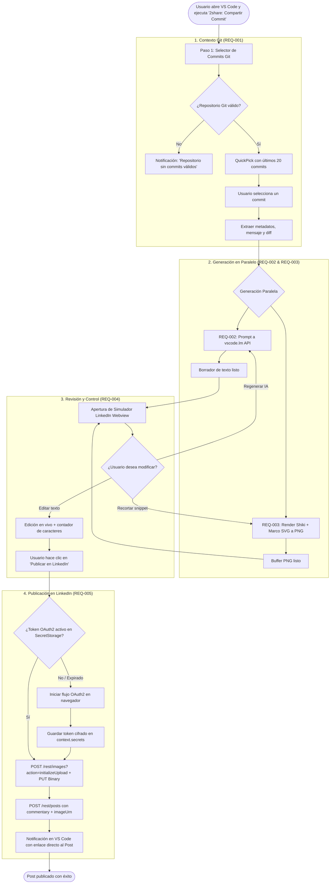
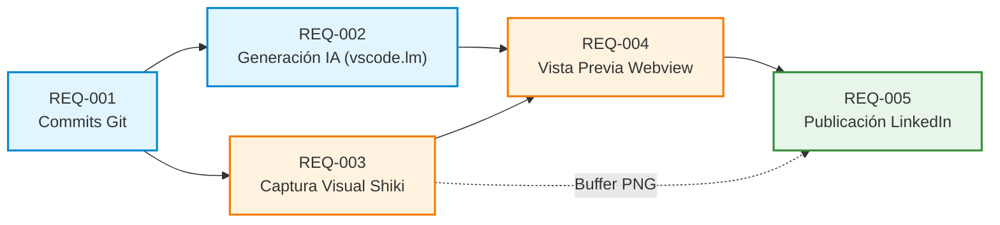
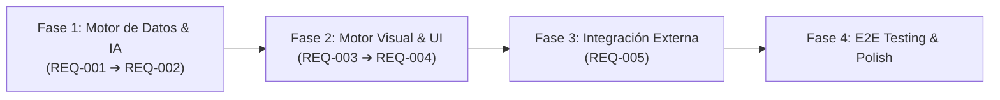

# EPIC-001: Plugin 2share para VS Code

## 1. Visión del Producto y Propuesta de Valor

### 1.1. El Problema
Los desarrolladores de software construyen y resuelven desafíos técnicos valiosos a diario en sus repositorios de código. Sin embargo, compartir este progreso en plataformas profesionales como LinkedIn representa una alta fricción:
- Requiere redactar explicaciones técnicas desde cero, consumiendo tiempo valioso.
- Generar capturas de pantalla de código atractivas obliga a usar herramientas externas (Ray.so, Carbon, capturas de pantalla con recortes manuales).
- Obliga a cambiar de contexto entre el editor de código, el navegador y herramientas de diseño.
- Muchos logros técnicos se quedan sin documentar o compartir debido a la fricción operativa.

### 1.2. La Propuesta de Valor de 2share
**2share** es una extensión para Visual Studio Code que transforma cualquier commit de Git en una publicación profesional, educativa y visualmente cautivadora para LinkedIn en menos de 30 segundos, todo sin salir del editor.

```
[ Commit Git en VS Code ] ➔ [ IA Local (vscode.lm) + Shiki Snippet ] ➔ [ Vista Previa Interactiva ] ➔ [ 1 Clic: Publicado en LinkedIn ]
```

### 1.3. Pilares Fundamentales
1. **Fricción Cero (In-Editor Experience):** Todo el flujo ocurre sin salir de VS Code, integrándose de forma natural con los flujos de trabajo diarios de Git.
2. **Cero Coste Adicional de IA:** Aprovecha los modelos de lenguaje ya disponibles y autenticados en el entorno del usuario (GitHub Copilot u otros modelos vía `vscode.lm`), eliminando la necesidad de API keys o pagos externos.
3. **Calidad Visual de Primer Nivel:** Genera snapshots de código estilizados con resaltado TextMate fiel a VS Code (usando Shiki), simulando marcos de ventana modernos tipo macOS.
4. **Control Total (Human-in-the-Loop):** El desarrollador siempre inspecciona, edita y valida el texto y la imagen en un simulador visual fiel a LinkedIn antes de publicar.
5. **Seguridad y Privacidad:** Almacenamiento seguro de credenciales con `SecretStorage` de VS Code y comunicación directa con las APIs oficiales de LinkedIn mediante OAuth 2.0.

---

## 2. Desglose de Requerimientos Atómicos

Esta épica central agrupa los 5 requerimientos funcionales atómicos del proyecto:

| ID | Requerimiento | Descripción Breve | Prioridad | Estado | Dependencias Inmediatas |
| :--- | :--- | :--- | :--- | :--- | :--- |
| **[[Requirements/REQ-001 - Seleccion y Extraccion de Commits Git\|REQ-001]]** | Selección y Extracción de Commits Git | Inspección del log de Git en el workspace activo y extracción del diff estructurado del commit seleccionado. | Alta | Implementado | Ninguna (Punto de entrada) |
| **[[Requirements/REQ-002 - Generacion de Post con IA de VS Code\|REQ-002]]** | Generación de Post con IA de VS Code | Redacción automatizada de un post estructurado (hook, problema/solución, aprendizajes y hashtags) usando `vscode.lm`. | Alta | Implementado | [[Requirements/REQ-001 - Seleccion y Extraccion de Commits Git\|REQ-001]] |
| **[[Requirements/REQ-003 - Captura Visual de Fragmentos de Codigo\|REQ-003]]** | Captura Visual de Fragmentos de Código | Renderizado de imágenes de código estilizadas (estilo Carbon/Ray.so) en alta resolución a partir del diff. | Alta | Implementado | [[Requirements/REQ-001 - Seleccion y Extraccion de Commits Git\|REQ-001]] |
| **[[Requirements/REQ-004 - Vista Previa y Edicion de Post\|REQ-004]]** | Vista Previa y Edición de Post | Panel Webview que simula la interfaz real de LinkedIn, permitiendo editar texto, ajustar snippet y disparar la acción de publicación. | Alta | Implementado | [[Requirements/REQ-002 - Generacion de Post con IA de VS Code\|REQ-002]], [[Requirements/REQ-003 - Captura Visual de Fragmentos de Codigo\|REQ-003]] |
| **[[Requirements/REQ-005 - Autenticacion y Publicacion en LinkedIn\|REQ-005]]** | Autenticación y Publicación en LinkedIn | Flujo OAuth 2.0 seguro, carga de assets a LinkedIn Images API y publicación del contenido mediante Posts API. | Alta | Implementado | [[Requirements/REQ-004 - Vista Previa y Edicion de Post\|REQ-004]], [[Requirements/REQ-003 - Captura Visual de Fragmentos de Codigo\|REQ-003]] |

---

## 3. Flujo de Usuario Extremo a Extremo (End-to-End User Journey)

### 3.1. Diagrama del Recorrido del Usuario


### 3.2. Descripción Paso a Paso del Recorrido
1. **Inicio:** El desarrollador termina una funcionalidad, realiza su commit y abre la paleta de comandos (`Cmd+Shift+P` / `Ctrl+Shift+P`) seleccionando `2share: Compartir Commit` (o usa el botón en la barra de estado de Git).
2. **Selección del Cambio:** Visualiza los commits recientes con sus mensajes y hashes. Al elegir uno, la extensión analiza los archivos modificados y prepara el diff.
3. **Generación Automatizada:**
   - En segundo plano, `vscode.lm` analiza el diff y redacta un borrador estructurado optimizado para engagement técnico en LinkedIn.
   - En paralelo, el motor Shiki toma el fragmento más representativo del diff y genera una captura visual con estilo IDE moderno (bordes redondeados, padding, controles de ventana).
4. **Inspección y Ajuste:** Se abre una pestaña de Webview con el diseño exacto de una publicación de LinkedIn. El usuario puede retocar el texto, alterar los hashtags o seleccionar líneas adicionales de código.
5. **Publicación en 1 Clic:** Al pulsar "Publicar", si es su primera vez, autoriza la aplicación en su navegador en segundos. La imagen se sube a LinkedIn Assets API y la publicación se difunde de inmediato. Una notificación emergente le permite ver el post publicado en su feed.

---

## 4. Matriz de Dependencias y Contratos de Datos

### 4.1. Grafo de Dependencias entre Requerimientos


### 4.2. Flujo de Datos y Contratos entre Módulos
1. **`REQ-001` ➔ `REQ-002` & `REQ-003`:**
   - Tipo de salida: `GitCommitContext` (hash, message, author, changedFiles, unifiedDiff).
2. **`REQ-002` ➔ `REQ-004`:**
   - Tipo de salida: `string` (post text con markdown para LinkedIn, hook, párrafos y hashtags).
3. **`REQ-003` ➔ `REQ-004` & `REQ-005`:**
   - Tipo de salida: `CodeSnippetSnapshot` (imageBuffer `Buffer`, mimeType `image/png`, metadata de lenguaje y líneas).
4. **`REQ-004` ➔ `REQ-005`:**
   - Tipo de salida: `LinkedInPostPayload` (finalText, imageBuffer o dataUrl, visibility: PUBLIC).

---

## 5. Orden Sugerido de Implementación para el Agente Maker

Siguiendo el patrón arquitectónico establecido en [[Decisions/ADR-001 - Patron Maker-Checker para Flujo de Trabajo con Agentes y PRs|ADR-001]], el Agente Maker debe abordar la implementación en ramas independientes mediante las siguientes fases secuenciales:



### Fase 1: Cimientos de Datos y Contenido (Sprints 1 y 2)
1. **Sprint 1.1 — `feat/REQ-001-git-commit-extraction`:**
   - **Objetivo:** Servicio Git que interactúa con `vscode.git` API y fallback a CLI.
   - **Entregables:** QuickPick de selección de commits y extractor de diff estructurado.
   - **Justificación:** Es la fuente de entrada de datos primaria. Sin un diff y mensaje limpios, ningún paso subsiguiente puede operar.
2. **Sprint 1.2 — `feat/REQ-002-ai-post-generation`:**
   - **Objetivo:** Cliente de `vscode.lm` para consumir modelos locales (Copilot/GPT-4o) con prompt engineering especializado en posts técnicos.
   - **Entregables:** Servicio generador de texto con streaming y manejo de fallbacks si no hay modelo disponible.
   - **Justificación:** Valida de inmediato la viabilidad de la integración con la API de IA de VS Code.

### Fase 2: Experiencia Visual y Presentación (Sprints 3 y 4)
3. **Sprint 2.1 — `feat/REQ-003-code-snippet-snapshot`:**
   - **Objetivo:** Motor de renderizado de código con Shiki y exportación de SVG/PNG de alta definición con marco de ventana decorativo.
   - **Entregables:** Módulo autónomo que recibe un bloque de código y produce un buffer PNG listo para publicarse.
   - **Justificación:** Se puede desarrollar y probar de forma desacoplada de la UI completa.
4. **Sprint 2.2 — `feat/REQ-004-webview-preview-editor`:**
   - **Objetivo:** Webview panel simulando el feed de LinkedIn con edición interactiva en vivo y controles de regeneración.
   - **Entregables:** Componentes UI de vista previa, bus de mensajería `vscode.postMessage` y sincronización bidireccional de estado.
   - **Justificación:** Une las salidas de REQ-002 y REQ-003 en una experiencia de usuario unificada antes de conectar APIs externas.

### Fase 3: Integración de Red y Publicación (Sprint 5)
5. **Sprint 3.1 — `feat/REQ-005-linkedin-oauth-publishing`:**
   - **Objetivo:** Flujo OAuth 2.0 (PKCE o local callback), almacenamiento seguro de tokens con `SecretStorage`, upload a LinkedIn Assets API y publicación a Posts API.
   - **Entregables:** `LinkedInClient` robusto con manejo de errores 401/403, renovación de tokens y confirmación con URI del post.
   - **Justificación:** Requiere que el payload esté completamente definido en REQ-004 para probar la carga real de texto e imagen de punta a punta.

### Fase 4: Integración Extremo a Extremo, Telemetría y Cierre
6. **Sprint 4.1 — `feat/E2E-integration-and-polish`:**
   - Integración total del pipeline, pruebas de usuario con repositorios reales, pruebas sin conexión a internet y refinamiento de estilos.

---

## 6. Criterios de Aceptación Globales de la Épica (Definition of Done)
- [ ] Todos los requerimientos individuales ([[Requirements/REQ-001 - Seleccion y Extraccion de Commits Git|REQ-001]] a [[Requirements/REQ-005 - Autenticacion y Publicacion en LinkedIn|REQ-005]]) han sido implementados y verificados según sus criterios Gherkin.
- [ ] El flujo completo desde seleccionar un commit hasta ver el post publicado en LinkedIn toma menos de 45 segundos en una conexión estándar.
- [ ] Cumplimiento del estándar **Maker-Checker** ([[Decisions/ADR-001 - Patron Maker-Checker para Flujo de Trabajo con Agentes y PRs|ADR-001]]): cada funcionalidad cuenta con PR revisado y tests unitarios.
- [ ] No se exponen credenciales, tokens ni claves en texto plano (uso estricto de `SecretStorage`).
- [ ] El rendimiento del editor VS Code no se degrada (operaciones pesadas de Shiki e IA ejecutadas en background de forma asíncrona).

---

## 7. Dependencias y Enlaces
- Proyecto: [[Projects/2share]]
- Tablero de Requerimientos: [[Requirements/Tablero de Requerimientos.base|Tablero de Requerimientos]]
- Decisión de Arquitectura: [[Decisions/ADR-001 - Patron Maker-Checker para Flujo de Trabajo con Agentes y PRs|ADR-001]]
- Requerimientos Hijos:
  - [[Requirements/REQ-001 - Seleccion y Extraccion de Commits Git|REQ-001: Selección y Extracción de Commits Git]]
  - [[Requirements/REQ-002 - Generacion de Post con IA de VS Code|REQ-002: Generación de Post con IA de VS Code]]
  - [[Requirements/REQ-003 - Captura Visual de Fragmentos de Codigo|REQ-003: Captura Visual de Fragmentos de Código]]
  - [[Requirements/REQ-004 - Vista Previa y Edicion de Post|REQ-004: Vista Previa y Edición de Post]]
  - [[Requirements/REQ-005 - Autenticacion y Publicacion en LinkedIn|REQ-005: Autenticación y Publicación en LinkedIn]]

